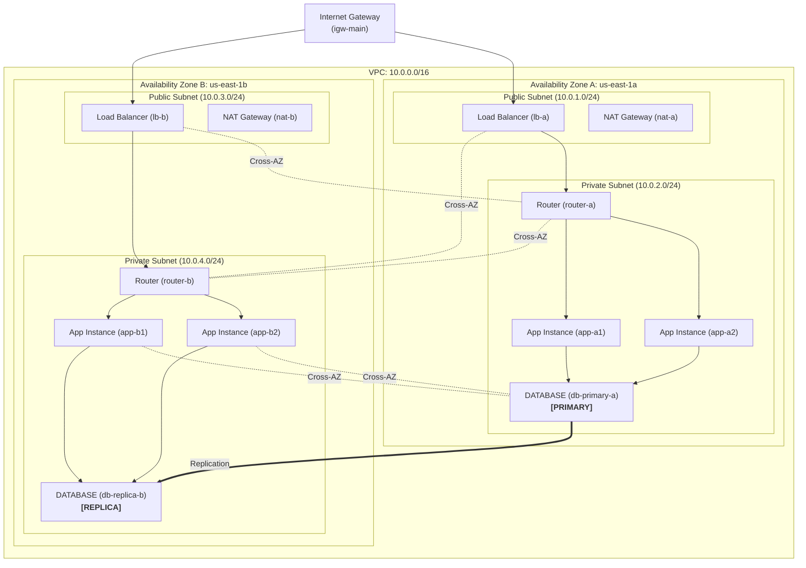
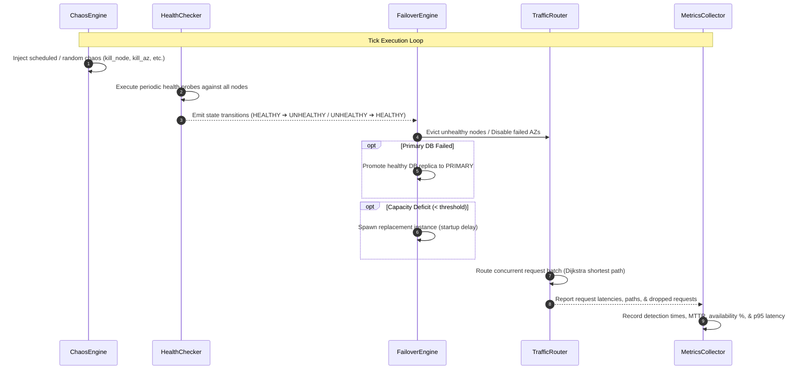

# ChaosNet: Interactive Cloud VPC & Auto-Failover Simulator

[](https://www.python.org/downloads/)
[](https://fastapi.tiangolo.com/)
[](https://networkx.org/)
[](https://docs.pydantic.dev/)
[](https://pytest.org/)
[](https://opensource.org/licenses/MIT)

**ChaosNet** is an interactive, deterministic cloud VPC simulator modeled after enterprise AWS architectures. It simulates multi-Availability Zone networks, routes requests over role-aware shortest paths with latency edge-weighting, allows users to inject chaos failures (node crashes, link drops, latency spikes, packet loss, network partitions, and primary database outages), and observes a control-plane auto-failover engine detect issues, reroute traffic, promote database replicas, dynamically scale instances, and track exact Mean Time to Recovery (MTTR) metrics.

---

## Architecture & System Design

### 1. Multi-AZ VPC Topology Diagram



---

### 2. Subsystem Interaction Flow



---

## Key Engineering Decisions

1. **Role-Aware Dijkstra Shortest-Path Routing**:
   - Routes request packets using `networkx.dijkstra_path` with a custom weight function: `link.latency + target_node.latency_ms`.
   - Strictly enforces network semantics: leaf nodes (`APP_INSTANCE`, `DATABASE`, `NAT_GATEWAY`) cannot act as unauthorized transit routers for unrelated hops.
   - Evaluates link propagation latency, node processing latency, capacity constraints, and link packet loss.

2. **Realistic Control-Plane Detection Lag**:
   - Real cloud load balancers do not discover node crashes instantly. ChaosNet models realistic detection lag via configurable probe intervals, timeouts, and consecutive thresholds:
     - `unhealthy_threshold = 3`: A node must fail 3 consecutive probes to be marked `UNHEALTHY`.
     - `healthy_threshold = 2`: A recovering node must pass 2 consecutive probes before re-entering the target pool, preventing flapping nodes from causing flapping outages.
   - `TrafficRouter(ignore_undetected_down=True)` generates realistic dropped requests during the window between failure onset and health check eviction.

3. **Multi-AZ Database Promotion (No Split-Brain)**:
   - When the `PRIMARY` database node fails, `FailoverEngine` promotes an active `REPLICA` in another AZ to `PRIMARY`.
   - If the old primary restarts, it rejoins the cluster as a `REPLICA`, preventing split-brain writes (matching AWS Aurora / RDS Multi-AZ architecture).

4. **Dynamic Auto-Scaling with Boot Latency**:
   - When healthy capacity drops below a configurable threshold (e.g. 600 units), the auto-scaling engine provisions replacement instances in healthy AZs.
   - Instances require `startup_delay_ticks` (e.g. 3 ticks) to boot before dynamically joining the `networkx` topology, wiring into subnet routers and databases, and joining the load balancer pool.

5. **100% Deterministic & Reproducible**:
   - Discrete tick-based simulation. Zero real-time sleeps in the core logic.
   - Seeded pseudo-random number generator (`seed=42`), guaranteeing that identical scenarios produce bit-for-bit identical metric timelines and latency distributions.

6. **Clean Architecture (Decoupled Core)**:
   - `chaosnet/core/` has **zero** FastAPI/Uvicorn dependencies and can be used as a standalone Python library or CLI simulator.
   - `chaosnet/api/` exposes REST endpoints and real-time WebSocket event streams.

---

## Project Structure

```
ChaosNet/
├── chaosnet/
│   ├── __init__.py
│   ├── api/
│   │   ├── __init__.py
│   │   └── main.py              # FastAPI app, REST endpoints & WebSocket streaming
│   └── core/
│       ├── __init__.py
│       ├── models.py            # Pydantic domain models (VPC, AZ, Subnet, Node, Link)
│       ├── topology.py          # NetworkX DiGraph manager, scenario loader, DOT export
│       ├── traffic.py           # Request generator, LB strategies, shortest-path routing
│       ├── health.py            # Control-plane health checker & detection lag tracking
│       ├── chaos.py             # 7 failure primitives, network partitions, seeded RNG
│       ├── failover.py          # LB eviction, DB replica promotion, auto-scaling
│       ├── metrics.py           # MTTR, detection time, p95 latencies, timeline, reports
│       └── engine.py            # Central tick-based simulation loop orchestrator
├── scenarios/
│   ├── default_vpc.json         # 2-AZ reference VPC topology (10.0.0.0/16)
│   └── az_failure.json          # 2-AZ topology with scripted AZ outage & recovery
├── tests/
│   ├── test_phase1_topology.py  # Graph topology, Pydantic validations, DOT exports
│   ├── test_phase2_traffic.py   # Dijkstra routing, load balancing, exact latency math
│   ├── test_phase3_health.py    # Consecutive thresholds, detection lag, timeout probes
│   ├── test_phase4_chaos.py     # 7 failure primitives, partitions, scripted recovery
│   ├── test_phase5_failover.py  # LB target eviction, DB promotion, auto-scaling
│   ├── test_phase6_metrics.py   # MTTR, p95 latency, JSON/table report generation
│   ├── test_phase7_api_cli.py   # FastAPI endpoints, WebSocket streams, CLI runner
│   └── test_phase8_end_to_end.py# Multi-failure integration, flapping hysteresis, seeds
├── cli.py                       # Command-line interface runner & API server launcher
├── pyproject.toml               # Package build configuration & dependencies
└── README.md                    # Project documentation & architecture reference
```

---

## Quickstart & Installation

### Requirements
- **Python 3.11+**
- Linux, macOS, or Windows WSL

### Setup

```bash
# 1. Clone the repository
git clone https://github.com/your-username/ChaosNet.git
cd ChaosNet

# 2. Create and activate a virtual environment
python3 -m venv .venv
source .venv/bin/activate

# 3. Install in editable mode with development dependencies
pip install -e ".[dev]"
```

---

## Command-Line Interface (CLI)

ChaosNet includes a rich CLI ([`cli.py`](file:///home/harshil/STUDY/ChaosNet/cli.py)) for running scenarios, inspecting topologies, and serving the API.

### 1. Run a Simulation Scenario
Execute a scenario script, stream real-time event logs to stdout, and view the executive summary report:

```bash
python cli.py run scenarios/az_failure.json --ticks 300
```

#### CLI Options for `run`:
- `--ticks <N>`: Number of ticks to simulate (default: 150).
- `--requests-per-tick <M>`: Concurrent requests generated per tick (default: 5).
- `--strategy ROUND_ROBIN|LEAST_CONNECTIONS`: Load balancing strategy (default: ROUND_ROBIN).
- `--seed <S>`: RNG seed for reproducible packet loss and random chaos (default: 42).
- `-v, --verbose`: Print per-tick traffic volume, latency, and success rates.
- `--output-json <path>`: Export full post-run metrics summary to a JSON file.

### 2. Inspect a Topology
Print an ASCII hierarchy of Availability Zones, Subnets, compute nodes, and network links:

```bash
python cli.py inspect scenarios/default_vpc.json
```

### 3. Launch the API & WebSocket Server
```bash
python cli.py serve --host 127.0.0.1 --port 8000
```

---

## REST & WebSocket API Reference

The FastAPI server provides programmatic simulation control, live WebSocket event streaming, and chaos injection:

| Method | Endpoint | Description |
|---|---|---|
| `GET` | `/topology` | Return full VPC graph (nodes, links, operational states, CIDRs) |
| `POST` | `/chaos/{event_type}` | Inject chaos failure (`kill_node`, `kill_az`, `drop_link`, `latency_spike`, `packet_loss`, `network_partition`, `db_primary_failure`, `recover`) |
| `POST` | `/simulation/step` | Advance simulation by exactly 1 tick and return tick metrics |
| `POST` | `/simulation/start` | Start continuous background ticking loop (`tick_rate_hz`) |
| `POST` | `/simulation/pause` | Pause continuous simulation ticking |
| `POST` | `/simulation/reset` | Reset simulation state back to tick 0 |
| `GET` | `/metrics` | Return cumulative simulation metrics, MTTR, detection times, p95 latencies, timeline, and incident reports |
| `WebSocket` | `/ws` | Bidirectional WebSocket streaming tick events and accepting control commands |

### WebSocket Protocol (`/ws`)

#### Server ➔ Client (Tick Update):
```json
{
  "type": "TICK_UPDATE",
  "tick": 54,
  "metric": {
    "tick": 54,
    "requests_sent": 5,
    "requests_succeeded": 5,
    "requests_failed": 0,
    "success_rate_pct": 100.0,
    "avg_latency_ms": 14.5,
    "p95_latency_ms": 16.3,
    "healthy_app_capacity": 500,
    "active_incidents": 1
  },
  "topology_summary": {
    "total_nodes": 13,
    "up_nodes": 7,
    "degraded_nodes": 0,
    "down_nodes": 6
  },
  "events": [
    {
      "tick": 54,
      "category": "FAILOVER",
      "event_type": "DB_PROMOTION",
      "target": "db-replica-b",
      "description": "Failover action db_promotion on 'db-replica-b': Promoted replica 'db-replica-b' to PRIMARY"
    }
  ]
}
```

#### Client ➔ Server Commands:
```json
// Advance 1 tick
{ "action": "step" }

// Inject chaos failure
{ "action": "inject", "event_type": "kill_node", "target": "app-a1", "duration": 10 }

// Start background continuous simulation
{ "action": "start", "tick_rate_hz": 2.0 }

// Pause simulation
{ "action": "pause" }

// Reset simulation
{ "action": "reset" }
```

---

## Sample Metrics Summary Report

Below is an authentic summary report generated by running `scenarios/az_failure.json` for 300 ticks:

```text
================================================================
               CHAOSNET SIMULATION SUMMARY REPORT               
================================================================
 Total Ticks Simulated:                  300
 Total Requests Generated:              1500
 Successful Requests:                   1480
 Failed Requests:                         20
 Availability (Uptime):               98.67%
----------------------------------------------------------------
 Mean Detection Time:                 0.00 ticks
 Mean Failover Time (MTTR):           0.00 ticks
 Requests Lost During Failover:           20
----------------------------------------------------------------
 Average Request Latency:            14.62 ms
 P95 Request Latency:                16.10 ms
 Min / Max Latency:             13.4ms / 16.3ms
----------------------------------------------------------------
 Total Chaos Incidents:                    1
================================================================
```

### Metrics Definitions:
- **Mean Detection Time**: Mean ticks elapsed between physical failure onset and control-plane health check detection.
- **Mean Failover Time (MTTR)**: Mean ticks elapsed between failure onset and complete failover mitigation (target eviction, DB promotion, or AZ rerouting).
- **Requests Lost During Failover**: The count of user requests that failed during the detection lag window before the load balancer evicted the failed resources.
- **P95 Request Latency**: 95th percentile end-to-end traversal latency (network link propagation + node internal processing) across all successful requests.
- **Availability (Uptime %)**: `(successful_requests / total_requests) * 100.0`.

---

## Test Suite

ChaosNet maintains a rigorous test suite with **44 automated tests** across all 8 phases.

Run tests:
```bash
pytest -v
```

### Test Coverage Breakdown:
- `test_phase1_topology.py`: Pydantic model validations, reference integrity, Graphviz DOT and ASCII summary exporters.
- `test_phase2_traffic.py`: Dijkstra shortest-path latency routing, Round Robin vs Least Connections distribution, link failure rerouting, packet loss.
- `test_phase3_health.py`: Consecutive check thresholds, detection lag calculations, probe timeout triggers on degraded nodes, recovery hysteresis.
- `test_phase4_chaos.py`: All 7 chaos primitives, cross-AZ network partitions, duration-based auto-recovery, scripted recovery, seeded random chaos reproducibility.
- `test_phase5_failover.py`: LB target pool eviction, database primary failure and replica promotion, multi-AZ failover, dynamic auto-scaling instance replacement.
- `test_phase6_metrics.py`: Detection time and MTTR accounting, p95 latency math, timeline logging, JSON/table report exports.
- `test_phase7_api_cli.py`: FastAPI REST endpoints, WebSocket streaming and interactive command handling, CLI runner execution.
- `test_phase8_end_to_end.py`: Cascading multi-point failures, flapping node hysteresis, multi-tier AZ + DB failover, bit-for-bit seed reproducibility.

---

## License

This project is licensed under the MIT License - see the LICENSE file for details.
